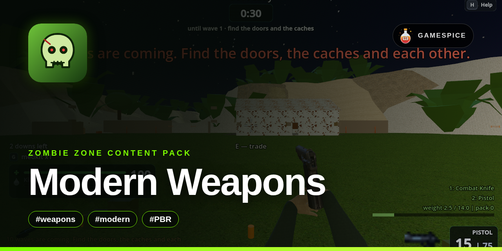

Twenty-eight modern weapons for [gs-weapon](https://github.com/gamespice-platform/weapon), each with a real PBR model and its own tuned profile: rifles, carbines, SMGs, pistols, shotguns, snipers, a machine gun, launchers, a frag grenade and six melee weapons (knife, machete, bat, crowbar, axe, sledgehammer). Every number below is a default read straight from the pack's data, and every one can be changed per game or per server without touching the pack. Made for Zombie Zone, usable in any game or server through Dot (`provides.json`, kind `weapon`, games `*`). The addon is `addons/zz_modern_weapons`.

### In GameSpice

- **[GameSpice](https://gamespice.net)**: the pack is published to the Workshop as `zz-modern-weapons`. Add it to a server's or game's pack list and its weapons appear in the spawn menu under Melee, Sidearms, Primary, Heavy and Thrown; players get it with the server's pack overlay, so there is nothing to install.
- **Playlot:** Playlot automatically places the pack's items into its spawn menu so you can test them there, or use the [Workbench](https://github.com/gamespice-platform/workbench) tool.
- **Your own Godot game:** link or copy `addons/zz_modern_weapons` beside gs-weapon and use the code in [Using it](#using-it).

Every weapon has a decimated PBR model. Metal keeps its authored values, so the view that draws it must give it something to reflect: see [docs/lighting.md](docs/lighting.md). Each weapon also has a `weight` in kg in its profile.

<!-- gen_readme:summary -->
| | Weapon | Class | Damage | Fire rate |
| --- | --- | --- | --- | --- |
| <a href="#m4-carbine">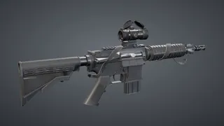</a> | [M4 Carbine](#m4-carbine) | Assault rifle | 29 | 800 rpm |
| <a href="#assault-rifle">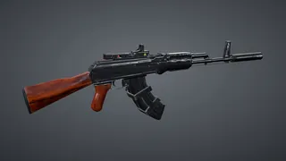</a> | [Assault Rifle](#assault-rifle) | Assault rifle | 34 | 600 rpm |
| <a href="#carbine">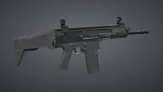</a> | [Carbine](#carbine) | Assault rifle | 26 | 700 rpm |
| <a href="#battle-rifle">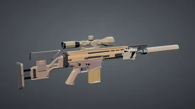</a> | [Battle Rifle](#battle-rifle) | Battle rifle | 46 | 420 rpm |
| <a href="#vss-vintorez"></a> | [VSS Vintorez](#vss-vintorez) | Suppressed rifle | 38 | 780 rpm |
| <a href="#smg">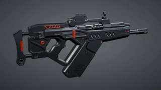</a> | [SMG](#smg) | SMG | 18 | 900 rpm |
| <a href="#mp5"></a> | [MP5](#mp5) | SMG | 22 | 750 rpm |
| <a href="#compact-smg">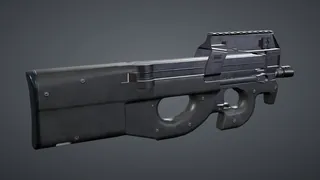</a> | [Compact SMG](#compact-smg) | SMG | 19 | 880 rpm |
| <a href="#shotgun"></a> | [Shotgun](#shotgun) | Shotgun | 12 x 9 | one shot every 0.86 s |
| <a href="#combat-shotgun">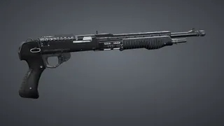</a> | [Combat Shotgun](#combat-shotgun) | Shotgun | 10 x 8 | one shot every 0.32 s |
| <a href="#auto-shotgun">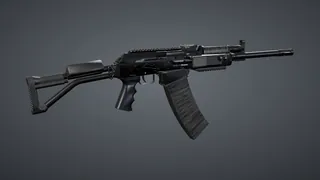</a> | [Auto Shotgun](#auto-shotgun) | Shotgun | 8 x 8 | 300 rpm |
| <a href="#pistol">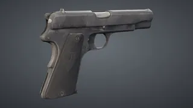</a> | [Pistol](#pistol) | Pistol | 24 | 330 rpm |
| <a href="#service-pistol"></a> | [Service Pistol](#service-pistol) | Pistol | 20 | 420 rpm |
| <a href="#hand-cannon">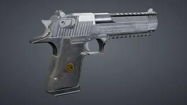</a> | [Hand Cannon](#hand-cannon) | Pistol | 78 | one shot every 0.46 s |
| <a href="#magnum-revolver"></a> | [Magnum Revolver](#magnum-revolver) | Pistol | 62 | one shot every 0.4 s |
| <a href="#marksman-rifle"></a> | [Marksman Rifle](#marksman-rifle) | Marksman rifle | 58 | one shot every 0.25 s |
| <a href="#hunting-rifle">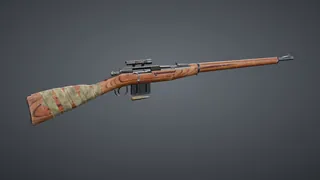</a> | [Hunting Rifle](#hunting-rifle) | Marksman rifle | 95 | one shot every 1.09 s |
| <a href="#sniper-rifle">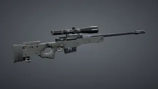</a> | [Sniper Rifle](#sniper-rifle) | Sniper rifle | 125 | one shot every 1.33 s |
| <a href="#light-machine-gun">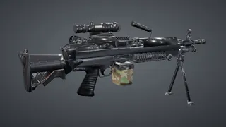</a> | [Light Machine Gun](#light-machine-gun) | Machine gun | 26 | 700 rpm |
| <a href="#grenade-launcher">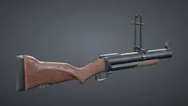</a> | [Grenade Launcher](#grenade-launcher) | Launcher | 30 | one shot every 1 s |
| <a href="#rocket-launcher">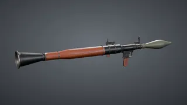</a> | [Rocket Launcher](#rocket-launcher) | Launcher | 60 | one shot every 2 s |
| <a href="#frag-grenade">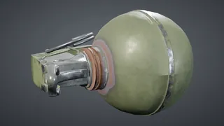</a> | [Frag Grenade](#frag-grenade) | Grenade | 120 splash | one throw every 1 s |
| <a href="#combat-knife">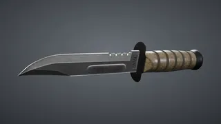</a> | [Combat Knife](#combat-knife) | Melee | 50 | one swing every 0.43 s |
| <a href="#machete">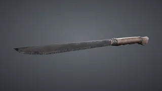</a> | [Machete](#machete) | Melee | 62 | one swing every 0.6 s |
| <a href="#baseball-bat">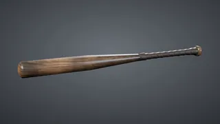</a> | [Baseball Bat](#baseball-bat) | Melee | 45 | one swing every 0.5 s |
| <a href="#crowbar">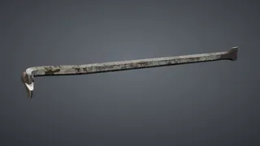</a> | [Crowbar](#crowbar) | Melee | 55 | one swing every 0.46 s |
| <a href="#axe"></a> | [Axe](#axe) | Melee | 85 | one swing every 0.8 s |
| <a href="#sledgehammer">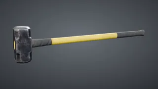</a> | [Sledgehammer](#sledgehammer) | Melee | 140 | one swing every 1.5 s |

*Rates are the time between shots and ignore reloading; rpm is the cyclic rate of an automatic weapon.*
<!-- /gen_readme:summary -->

## Using it

```gdscript
var catalogue := ZzWeaponPack.catalogue()      # a GSWeaponCatalogue
var model := ZzWeaponArt.instantiate(ZzWeaponIds.M4)
```

A game's spawn menu calls `ZzSpawnProvider.spawn_entries()` (in `addons/zz_modern_weapons/spawn_provider.gd`) and gets one `{category, id, name, icon, kind: "weapon", spawn, cfg_hint}` row per weapon. The Workshop form (`weapons/*.tres` and `provides.json`) is generated by `tools/export-defs.sh`.

## Settings

Every number is in a weapon profile, `cfg/addons/zz_modern_weapons/weapon/<id>.yml`: common keys at the top (damage, rate, recoil, spread, magazine, reload, range), the pack's own under `extra:`, and a `menu:` block. A weapon with upgrades has a folder with `upgrades/<id>.yml` (the rifle and the shotgun do).

```yaml
m4:
  damage: 35
  rpm: 700
  magazine: 20
```

Put your own changes in `cfg/game/<game>/weapon/` or `cfg/server/weapon/` and leave the shipped files alone. A key you do not list keeps its default; an unknown key is logged and ignored.

## Testing

`./game.sh test` parses every script and runs the pack's suite. `tools/screenshot.sh [--all|<weapon>]` renders the rack to `screenshots/`.

The weapon gallery and tables in this README are generated; edit the words in [docs/readme/weapons.yml](docs/readme/weapons.yml), never the tables:

- `tools/gen_readme.sh` renders every weapon in a studio scene (`tools/readme_shot.tscn`, light and pose in `tools/readme.cfg`) on a GPU box through `heavy`, writes `docs/img/<id>.webp` and `<id>_thumb.webp`, and rewrites the two generated regions of this file. `--ids zz_ak,zz_m4` re-renders only those.
- `tools/gen_readme.sh --text` rewrites the stat tables only, from `weapons/*.tres` and the profiles; run it after any tuning change. `--check` exits 1 when this file is out of date.
- The scripts are pack-agnostic: another pack copies `tools/readme_shot.*`, `tools/readme.cfg` (its art call or a model glob), `tools/gen_readme.*` and its own `docs/readme/weapons.yml`.

<!-- gen_readme:weapons -->
## The weapons

### M4 Carbine

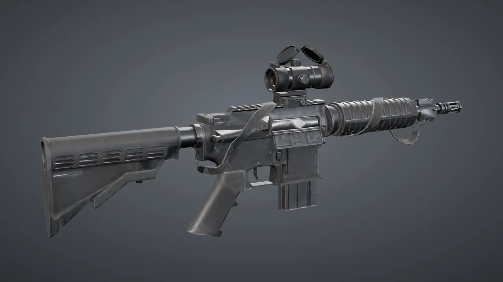

**Assault rifle** `zz_m4`. The all-rounder. Fast, controllable and the only rifle with a burst mode, with upgrade profiles for an extended magazine and hot loads.

| Default | |
| --- | --- |
| Damage | 29 (bullet) |
| Fire rate | 800 rpm |
| Fire modes | auto, semi, burst |
| Magazine | 30 + 150 reserve |
| Reload | 2.1 s |
| Spread | 0.45 deg standing, 2.2 moving, 0.35 crouched, 4.5 airborne |
| Bloom | +0.5 deg per shot, up to 4 |
| Recoil | 0.32 deg up, 0.14 deg side |
| Range | 400 m (falloff 40-120 m to 50 %) |
| Draw time | 0.35 s |
| Weight | 3.4 kg |

*Rates are the time between shots and ignore reloading; rpm is the cyclic rate of an automatic weapon.*

### Assault Rifle

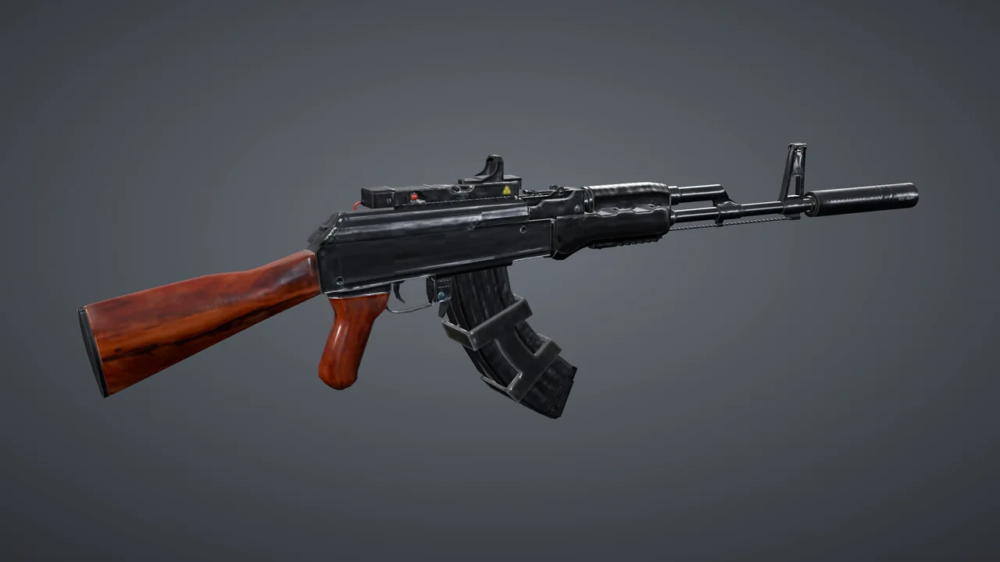

**Assault rifle** `zz_ak`. Hits harder than the M4 and kicks more for it. A wooden-furniture classic that still wins a fight at mid range.

| Default | |
| --- | --- |
| Damage | 34 (bullet) |
| Fire rate | 600 rpm |
| Fire modes | auto, semi |
| Magazine | 30 + 120 reserve |
| Reload | 2.4 s |
| Spread | 0.55 deg standing, 2.6 moving, 0.42 crouched, 5 airborne |
| Bloom | +0.6 deg per shot, up to 4.5 |
| Recoil | 0.55 deg up, 0.25 deg side |
| Range | 420 m (falloff 40-120 m to 50 %) |
| Draw time | 0.4 s |
| Weight | 4.3 kg |

*Rates are the time between shots and ignore reloading; rpm is the cyclic rate of an automatic weapon.*

### Carbine

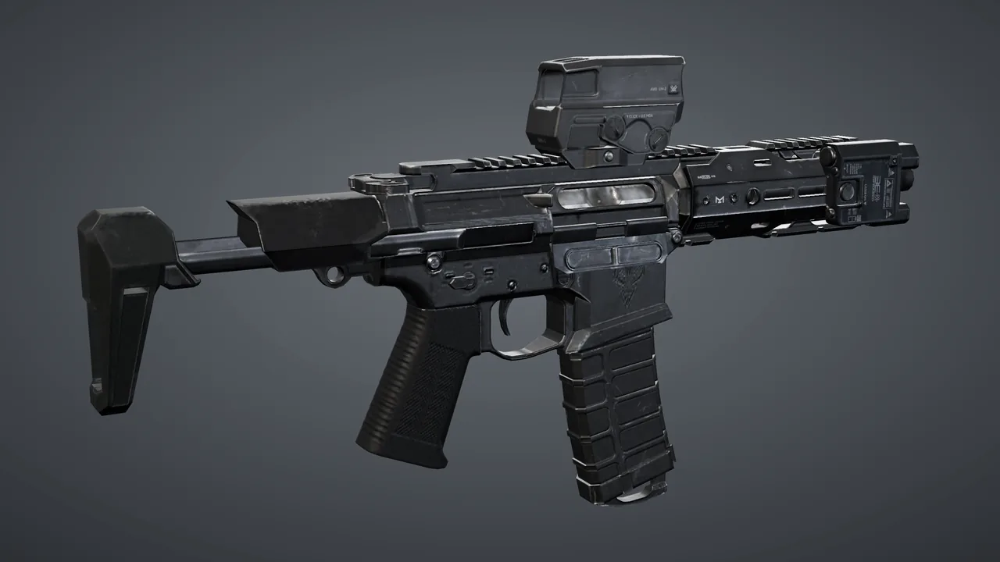

**Assault rifle** `zz_bren`. A modern carbine with a fast cycle, light recoil and a deep reserve. Easy to keep on target while you move.

| Default | |
| --- | --- |
| Damage | 26 (bullet) |
| Fire rate | 700 rpm |
| Fire modes | auto, semi |
| Magazine | 30 + 150 reserve |
| Reload | 2 s |
| Spread | 0.4 deg standing, 2 moving, 0.3 crouched, 4.2 airborne |
| Bloom | +0.5 deg per shot, up to 3.8 |
| Recoil | 0.3 deg up, 0.12 deg side |
| Range | 380 m (falloff 40-120 m to 50 %) |
| Draw time | 0.32 s |
| Weight | 3.1 kg |

*Rates are the time between shots and ignore reloading; rpm is the cyclic rate of an automatic weapon.*

### Battle Rifle

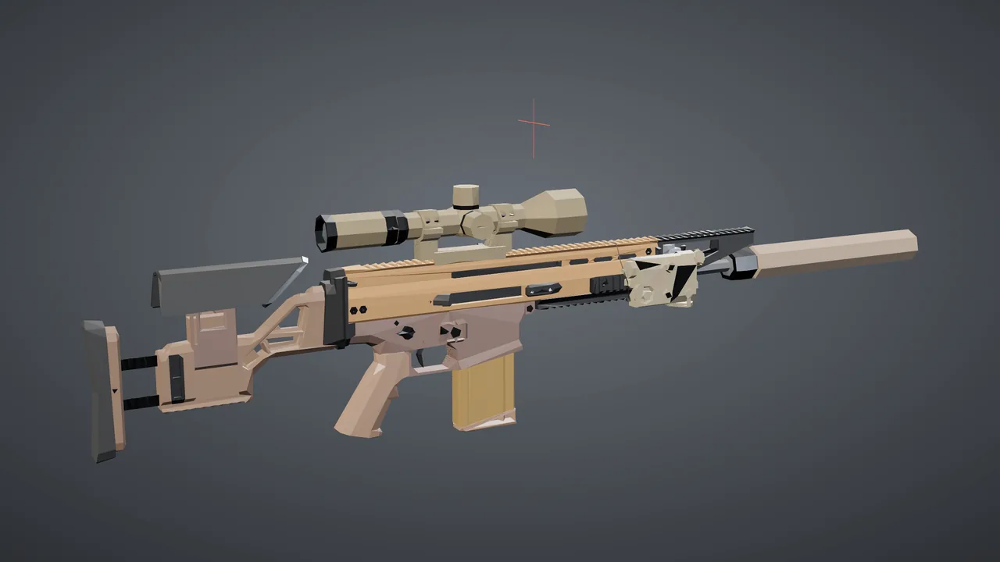

**Battle rifle** `zz_scar`. Full-power rounds in a 20-round magazine. Slower than the carbines, but two hits finish most targets at any range.

| Default | |
| --- | --- |
| Damage | 46 (bullet) |
| Fire rate | 420 rpm |
| Fire modes | auto, semi, burst |
| Magazine | 20 + 80 reserve |
| Reload | 2.5 s |
| Spread | 0.3 deg standing, 2.4 moving, 0.2 crouched, 5 airborne |
| Bloom | +0.6 deg per shot, up to 3.5 |
| Recoil | 0.8 deg up, 0.2 deg side |
| Range | 600 m (falloff 40-120 m to 50 %) |
| Draw time | 0.5 s |
| Weight | 4.8 kg |

*Rates are the time between shots and ignore reloading; rpm is the cyclic rate of an automatic weapon.*

### VSS Vintorez

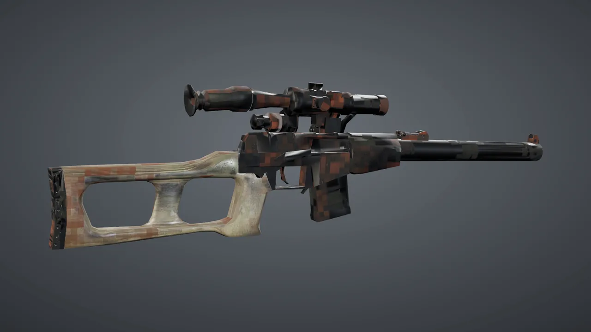

**Suppressed rifle** `zz_vss`. An integrally suppressed rifle that fires like an SMG and reaches like a marksman rifle. Quiet, quick and deadly.

| Default | |
| --- | --- |
| Damage | 38 (bullet) |
| Fire rate | 780 rpm |
| Fire modes | auto, semi |
| Magazine | 20 + 100 reserve |
| Reload | 2.5 s |
| Spread | 0.25 deg standing, 2 moving, 0.15 crouched, 4 airborne |
| Bloom | +0.35 deg per shot, up to 2.6 |
| Recoil | 0.5 deg up, 0.12 deg side |
| Range | 600 m (falloff 40-120 m to 50 %) |
| Draw time | 0.5 s |
| Weight | 2.6 kg |

*Rates are the time between shots and ignore reloading; rpm is the cyclic rate of an automatic weapon.*

### SMG

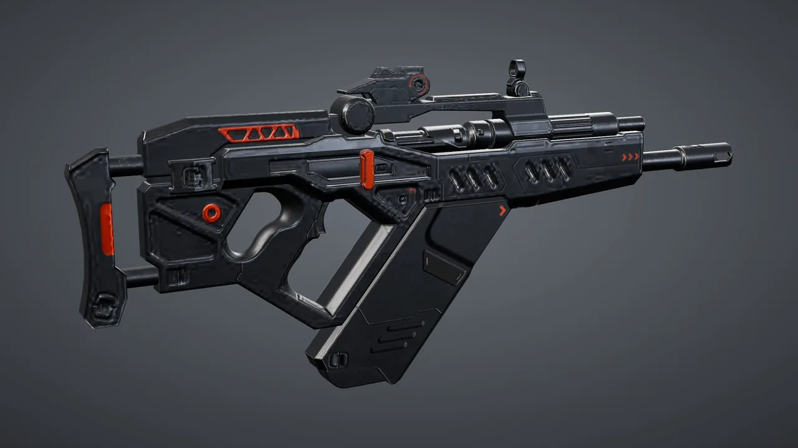

**SMG** `zz_smg`. The fastest gun in the pack. It shreds up close and falls away fast at distance.

| Default | |
| --- | --- |
| Damage | 18 (bullet) |
| Fire rate | 900 rpm |
| Fire modes | auto, semi, burst |
| Magazine | 32 + 160 reserve |
| Reload | 1.8 s |
| Spread | 0.7 deg standing, 2.4 moving, 0.6 crouched, 5 airborne |
| Bloom | +0.45 deg per shot, up to 4.5 |
| Recoil | 0.26 deg up, 0.14 deg side |
| Range | 120 m (falloff 40-120 m to 50 %) |
| Draw time | 0.26 s |
| Weight | 3 kg |

*Rates are the time between shots and ignore reloading; rpm is the cyclic rate of an automatic weapon.*

### MP5

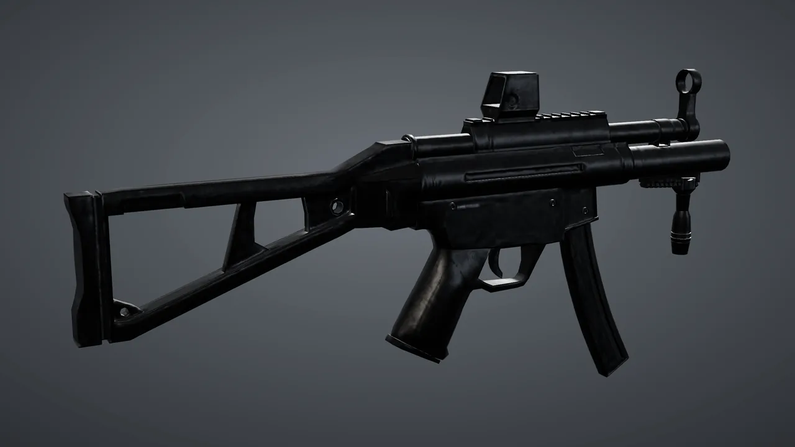

**SMG** `zz_mp5`. Precise and steady, with a three-round burst for picking shots. The SMG that still works across a street.

| Default | |
| --- | --- |
| Damage | 22 (bullet) |
| Fire rate | 750 rpm |
| Fire modes | auto, semi, burst |
| Magazine | 30 + 150 reserve |
| Reload | 2 s |
| Spread | 0.4 deg standing, 2 moving, 0.3 crouched, 4.5 airborne |
| Bloom | +0.5 deg per shot, up to 3.5 |
| Recoil | 0.3 deg up, 0.12 deg side |
| Range | 160 m (falloff 40-120 m to 50 %) |
| Draw time | 0.3 s |
| Weight | 2.5 kg |

*Rates are the time between shots and ignore reloading; rpm is the cyclic rate of an automatic weapon.*

### Compact SMG

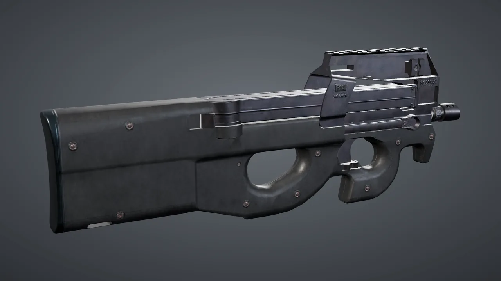

**SMG** `zz_p90`. A bullpup with a fifty-round magazine and a very high rate of fire. Hold the trigger and keep going.

| Default | |
| --- | --- |
| Damage | 19 (bullet) |
| Fire rate | 880 rpm |
| Fire modes | auto, semi |
| Magazine | 50 + 150 reserve |
| Reload | 2.3 s |
| Spread | 0.5 deg standing, 1.8 moving, 0.35 crouched, 4.5 airborne |
| Bloom | +0.4 deg per shot, up to 3 |
| Recoil | 0.22 deg up, 0.1 deg side |
| Range | 140 m (falloff 40-120 m to 50 %) |
| Draw time | 0.28 s |
| Weight | 2.8 kg |

*Rates are the time between shots and ignore reloading; rpm is the cyclic rate of an automatic weapon.*

### Shotgun

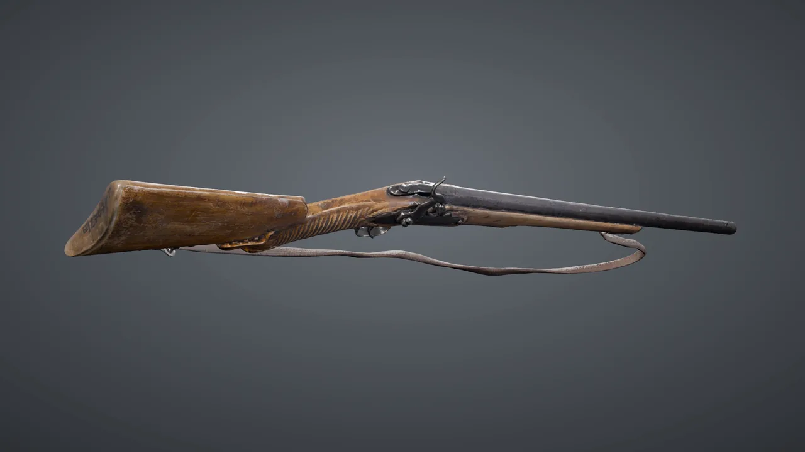

**Shotgun** `zz_shotgun`. A pump gun with nine pellets per shell, loaded a shell at a time. It ends a corridor fight in one shot.

| Default | |
| --- | --- |
| Damage | 12 x 9 pellets (bullet) |
| Fire rate | one shot every 0.86 s |
| Magazine | 8 + 32 reserve |
| Reload | 0.45 s per round |
| Spread | 4.2 deg standing, 0.5 moving, 1 airborne |
| Bloom | +1.2 deg per shot, up to 3 |
| Recoil | 2.6 deg up, 0.3 deg side |
| Range | 30 m |
| Draw time | 0.4 s |
| Weight | 3.6 kg |

*Rates are the time between shots and ignore reloading; rpm is the cyclic rate of an automatic weapon.*

### Combat Shotgun

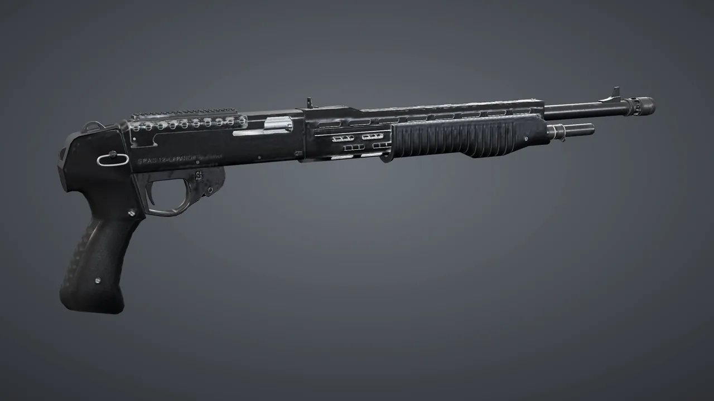

**Shotgun** `zz_spas`. A semi-auto combat shotgun. Fewer pellets than the pump, but nearly three times the rate of fire.

| Default | |
| --- | --- |
| Damage | 10 x 8 pellets (bullet) |
| Fire rate | one shot every 0.32 s |
| Magazine | 8 + 32 reserve |
| Reload | 0.5 s per round |
| Spread | 4.8 deg standing, 0.6 moving, 1.2 airborne |
| Bloom | +1 deg per shot, up to 3 |
| Recoil | 2 deg up, 0.3 deg side |
| Range | 28 m |
| Draw time | 0.45 s |
| Weight | 4.2 kg |

*Rates are the time between shots and ignore reloading; rpm is the cyclic rate of an automatic weapon.*

### Auto Shotgun

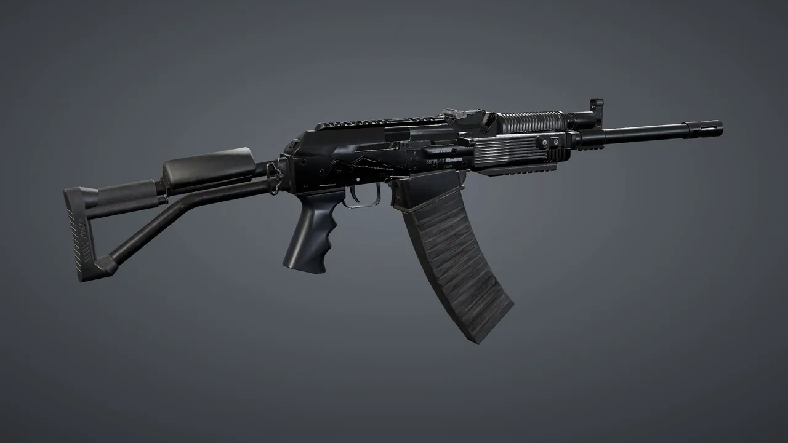

**Shotgun** `zz_aa12`. A fully automatic shotgun fed from a long 20-shell box magazine. Brutal inside a room, wasteful anywhere else.

| Default | |
| --- | --- |
| Damage | 8 x 8 pellets (bullet) |
| Fire rate | 300 rpm |
| Magazine | 20 + 40 reserve |
| Reload | 3.4 s |
| Spread | 5.2 deg standing, 0.8 moving, 1.4 airborne |
| Bloom | +0.8 deg per shot, up to 3 |
| Recoil | 1.5 deg up, 0.35 deg side |
| Range | 26 m |
| Draw time | 0.6 s |
| Weight | 5.2 kg |

*Rates are the time between shots and ignore reloading; rpm is the cyclic rate of an automatic weapon.*

### Pistol


**Pistol** `zz_pistol`. A dependable sidearm with a fast draw and a fifteen-round magazine.

| Default | |
| --- | --- |
| Damage | 24 (bullet) |
| Fire rate | 330 rpm |
| Magazine | 15 + 75 reserve |
| Reload | 1.5 s |
| Spread | 0.5 deg standing, 1.8 moving, 0.4 crouched, 3.5 airborne |
| Bloom | +0.35 deg per shot, up to 3 |
| Recoil | 0.9 deg up, 0.2 deg side |
| Range | 200 m (falloff 40-120 m to 50 %) |
| Draw time | 0.25 s |
| Weight | 1 kg |

*Rates are the time between shots and ignore reloading; rpm is the cyclic rate of an automatic weapon.*

### Service Pistol

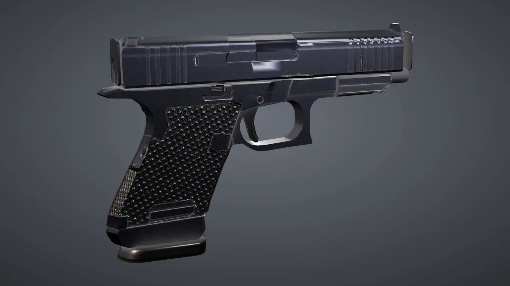

**Pistol** `zz_glock`. A polymer service pistol that trades damage for rate of fire and a seventeen-round magazine.

| Default | |
| --- | --- |
| Damage | 20 (bullet) |
| Fire rate | 420 rpm |
| Magazine | 17 + 85 reserve |
| Reload | 1.4 s |
| Spread | 0.55 deg standing, 1.8 moving, 0.4 crouched, 3.5 airborne |
| Bloom | +0.5 deg per shot, up to 2.8 |
| Recoil | 0.45 deg up, 0.16 deg side |
| Range | 180 m (falloff 40-120 m to 50 %) |
| Draw time | 0.22 s |
| Weight | 0.8 kg |

*Rates are the time between shots and ignore reloading; rpm is the cyclic rate of an automatic weapon.*

### Hand Cannon

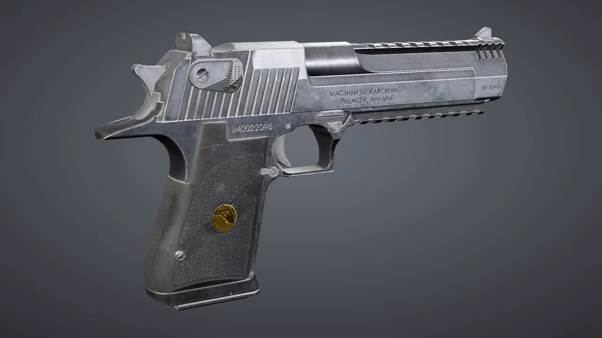

**Pistol** `zz_deagle`. A rifle round in a pistol frame. Seven shots, heavy kick, and very few targets take two.

| Default | |
| --- | --- |
| Damage | 78 (bullet) |
| Fire rate | one shot every 0.46 s |
| Magazine | 7 + 28 reserve |
| Reload | 2.2 s |
| Spread | 0.35 deg standing, 2.2 moving, 0.25 crouched, 4.2 airborne |
| Bloom | +0.8 deg per shot, up to 3.2 |
| Recoil | 2.8 deg up, 0.5 deg side |
| Range | 280 m (falloff 40-120 m to 50 %) |
| Draw time | 0.35 s |
| Weight | 1.8 kg |

*Rates are the time between shots and ignore reloading; rpm is the cyclic rate of an automatic weapon.*

### Magnum Revolver

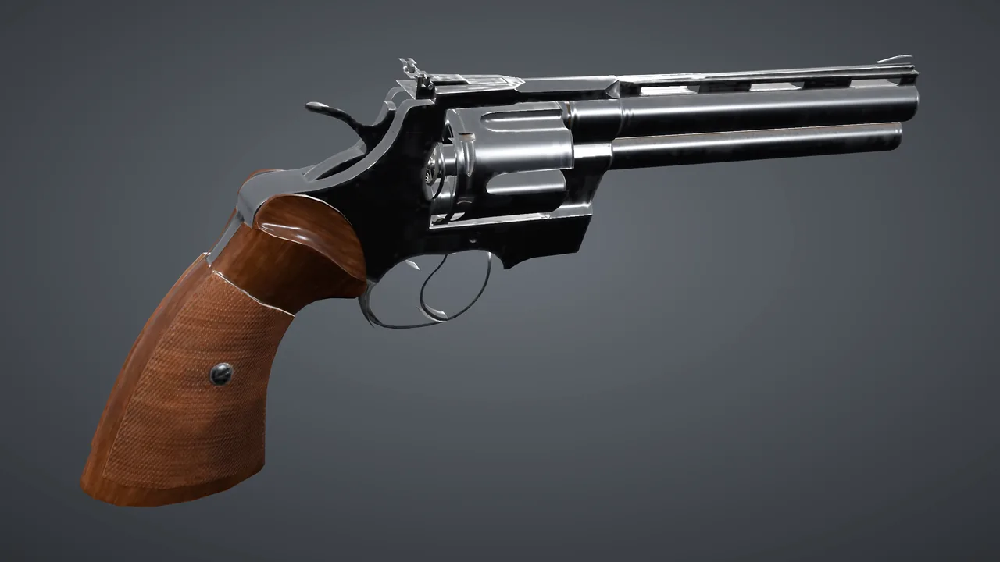

**Pistol** `zz_revolver`. A six-shot magnum. Slow to fire and slow to reload, and every shot counts.

| Default | |
| --- | --- |
| Damage | 62 (bullet) |
| Fire rate | one shot every 0.4 s |
| Magazine | 6 + 36 reserve |
| Reload | 2.6 s |
| Spread | 0.3 deg standing, 2 moving, 0.2 crouched, 4 airborne |
| Bloom | +0.6 deg per shot, up to 3 |
| Recoil | 2.2 deg up, 0.4 deg side |
| Range | 260 m (falloff 40-120 m to 50 %) |
| Draw time | 0.3 s |
| Weight | 1.2 kg |

*Rates are the time between shots and ignore reloading; rpm is the cyclic rate of an automatic weapon.*

### Marksman Rifle

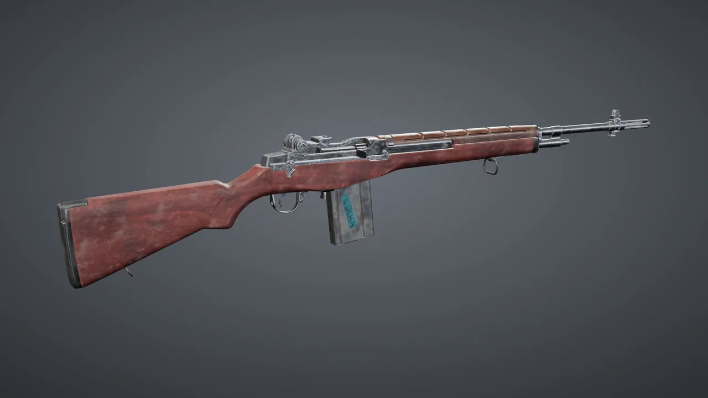

**Marksman rifle** `zz_dmr`. A semi-auto battle rifle tuned for accuracy. Long range without a bolt to work.

| Default | |
| --- | --- |
| Damage | 58 (bullet) |
| Fire rate | one shot every 0.25 s |
| Magazine | 20 + 80 reserve |
| Reload | 2.7 s |
| Spread | 0.1 deg standing, 3.5 moving, 0.05 crouched, 7 airborne |
| Bloom | +0.5 deg per shot, up to 2.5 |
| Recoil | 1.4 deg up, 0.25 deg side |
| Range | 700 m (falloff 40-120 m to 50 %) |
| Draw time | 0.55 s |
| Weight | 4.5 kg |

*Rates are the time between shots and ignore reloading; rpm is the cyclic rate of an automatic weapon.*

### Hunting Rifle

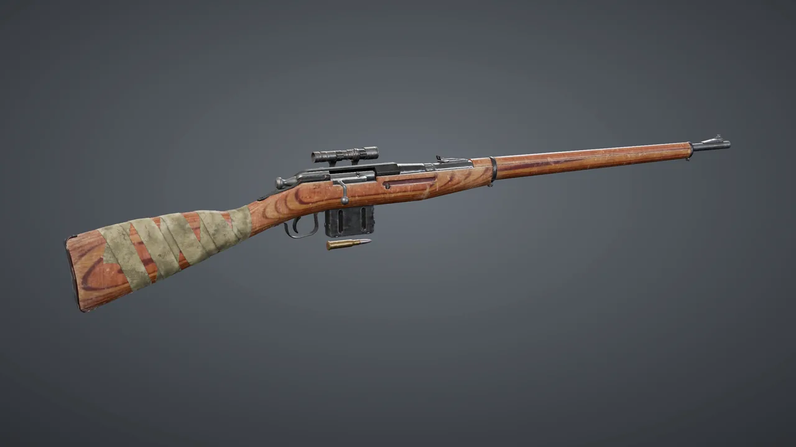

**Marksman rifle** `zz_hunting`. A wooden bolt-action rifle. Five shots, near-sniper damage and a quick handling time.

| Default | |
| --- | --- |
| Damage | 95 (bullet) |
| Fire rate | one shot every 1.09 s |
| Magazine | 5 + 30 reserve |
| Reload | 3 s |
| Spread | 0 deg standing, 5 moving, 10 airborne |
| Bloom | +2.5 deg per shot, up to 5 |
| Recoil | 2.6 deg up, 0.3 deg side |
| Range | 700 m (falloff 40-120 m to 50 %) |
| Draw time | 0.5 s |
| Weight | 4 kg |

*Rates are the time between shots and ignore reloading; rpm is the cyclic rate of an automatic weapon.*

### Sniper Rifle

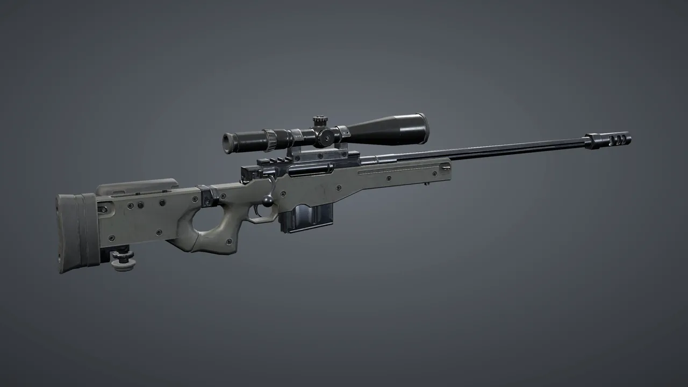

**Sniper rifle** `zz_sniper`. The longest reach and the biggest single hit in the pack. One shot, one kill, then a long bolt.

| Default | |
| --- | --- |
| Damage | 125 (bullet) |
| Fire rate | one shot every 1.33 s |
| Magazine | 5 + 20 reserve |
| Reload | 3.4 s |
| Spread | 0 deg standing, 9 moving, 15 airborne |
| Bloom | +3 deg per shot, up to 6 |
| Recoil | 4.2 deg up, 0.4 deg side |
| Range | 1000 m (falloff 40-120 m to 50 %) |
| Draw time | 0.75 s |
| Weight | 5.2 kg |

*Rates are the time between shots and ignore reloading; rpm is the cyclic rate of an automatic weapon.*

### Light Machine Gun

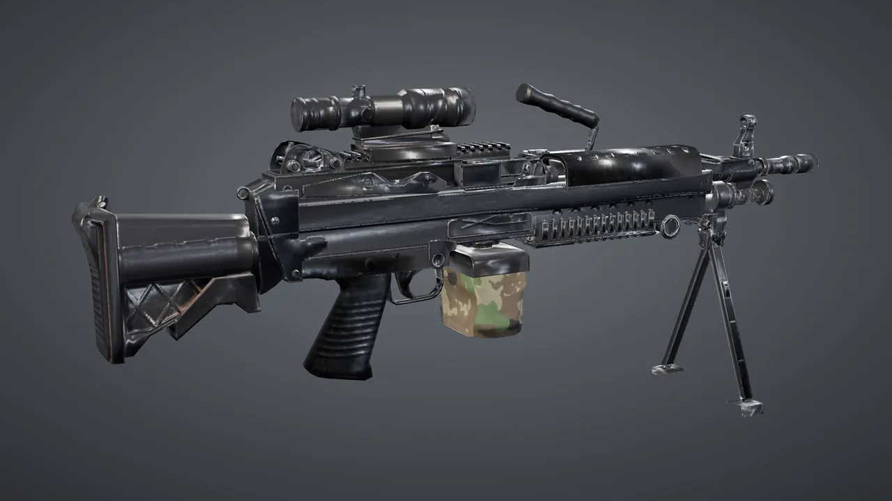

**Machine gun** `zz_lmg`. A belt-fed machine gun with a hundred-round box. Suppress a lane and hold it; just don't get caught reloading.

| Default | |
| --- | --- |
| Damage | 26 (bullet) |
| Fire rate | 700 rpm |
| Magazine | 100 + 200 reserve |
| Reload | 5.2 s |
| Spread | 0.9 deg standing, 3.2 moving, 0.6 crouched, 6 airborne |
| Bloom | +0.55 deg per shot, up to 5.5 |
| Recoil | 0.38 deg up, 0.22 deg side |
| Range | 450 m (falloff 40-120 m to 50 %) |
| Draw time | 0.9 s |
| Weight | 7.5 kg |

*Rates are the time between shots and ignore reloading; rpm is the cyclic rate of an automatic weapon.*

### Grenade Launcher

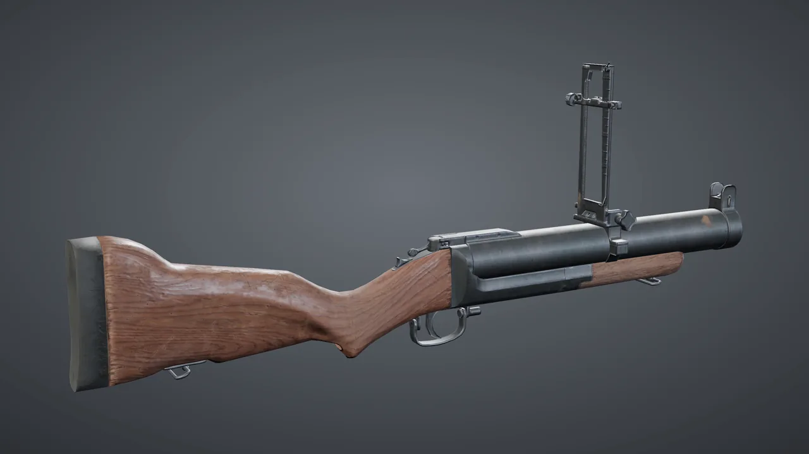

**Launcher** `zz_m79`. A single-shot break-action grenade launcher. Lob a round over cover and the blast does the rest.

| Default | |
| --- | --- |
| Damage | 30 (blast) |
| Splash | 150 within 5 m |
| Fire rate | one shot every 1 s |
| Magazine | 1 + 8 reserve |
| Reload | 2.4 s |
| Recoil | 3.5 deg up |
| Projectile speed | 40 m/s |
| Draw time | 0.5 s |
| Weight | 2.9 kg |

*Rates are the time between shots and ignore reloading; rpm is the cyclic rate of an automatic weapon.*

### Rocket Launcher

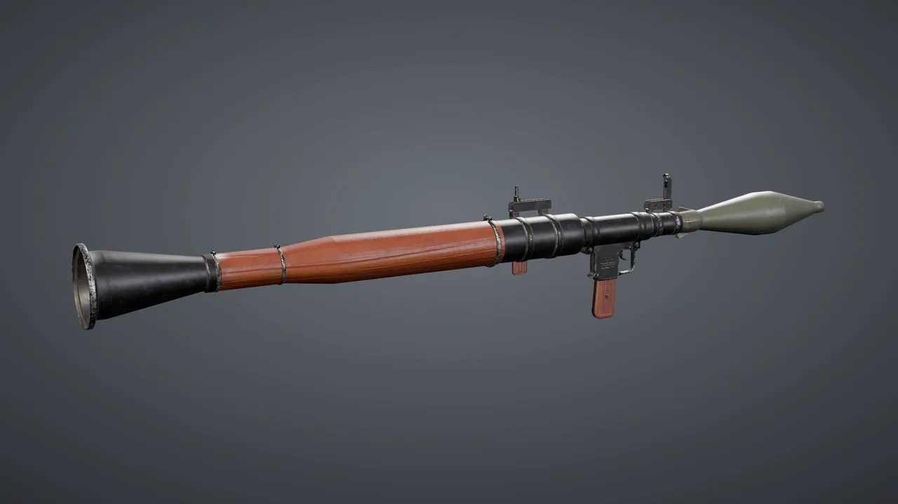

**Launcher** `zz_rpg`. A rocket launcher with the largest blast radius in the pack. For groups, cover and anything that will not move.

| Default | |
| --- | --- |
| Damage | 60 (blast) |
| Splash | 320 within 7.5 m |
| Fire rate | one shot every 2 s |
| Magazine | 1 + 3 reserve |
| Reload | 3.6 s |
| Recoil | 4.5 deg up |
| Projectile speed | 55 m/s |
| Draw time | 0.8 s |
| Weight | 6.4 kg |

*Rates are the time between shots and ignore reloading; rpm is the cyclic rate of an automatic weapon.*

### Frag Grenade

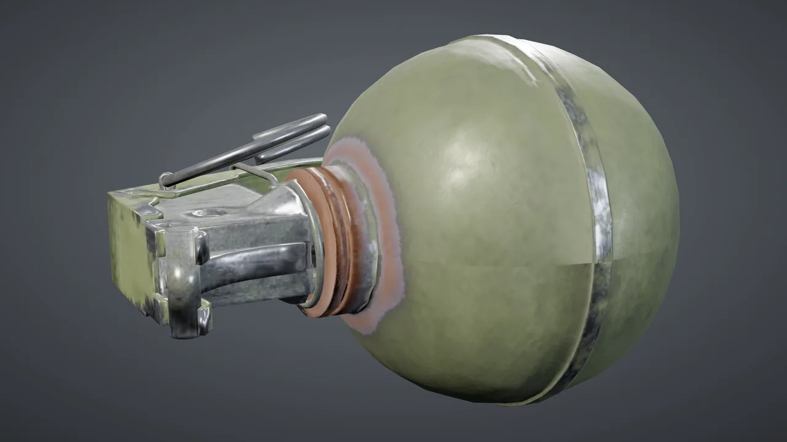

**Grenade** `zz_frag`. A fused fragmentation grenade. Throw it round a corner and clear the room.

| Default | |
| --- | --- |
| Splash | 120 within 5.5 m |
| Fire rate | one throw every 1 s |
| Carried | 2 (max 4) |
| Projectile speed | 19 m/s |
| Fuse | 3 s |
| Weight | 0.4 kg |

*Rates are the time between shots and ignore reloading; rpm is the cyclic rate of an automatic weapon.*

### Combat Knife

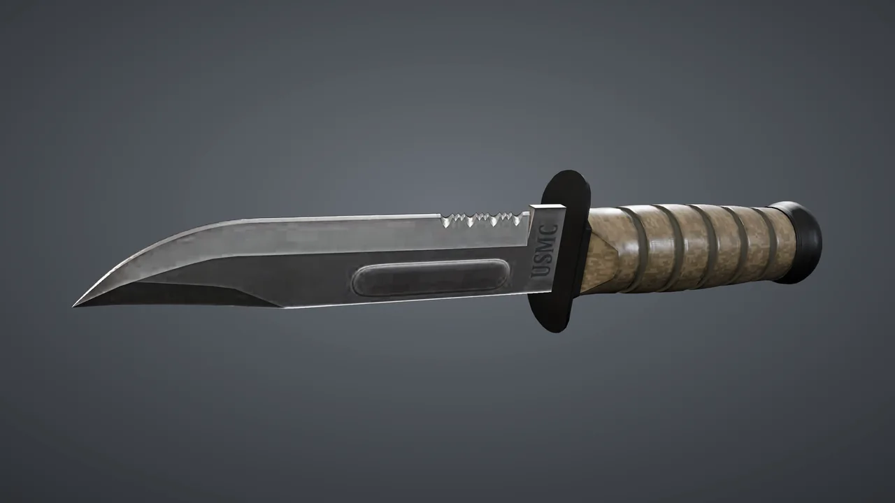

**Melee** `zz_knife`. A combat knife. The fastest swing in the pack and always in your hand.

| Default | |
| --- | --- |
| Damage | 50 (blade) |
| Fire rate | one swing every 0.43 s |
| Reach | 1.9 m |
| Swing arc | 26 deg |
| Draw time | 0.15 s |
| Weight | 0.3 kg |

*Rates are the time between shots and ignore reloading; rpm is the cyclic rate of an automatic weapon.*

### Machete

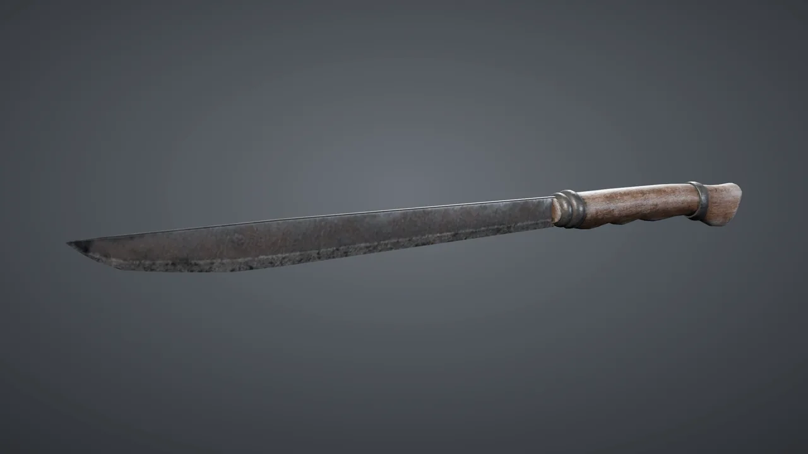

**Melee** `zz_machete`. A long blade that hits harder than the knife and reaches further.

| Default | |
| --- | --- |
| Damage | 62 (blade) |
| Fire rate | one swing every 0.6 s |
| Reach | 2.1 m |
| Swing arc | 34 deg |
| Draw time | 0.2 s |
| Weight | 0.9 kg |

*Rates are the time between shots and ignore reloading; rpm is the cyclic rate of an automatic weapon.*

### Baseball Bat

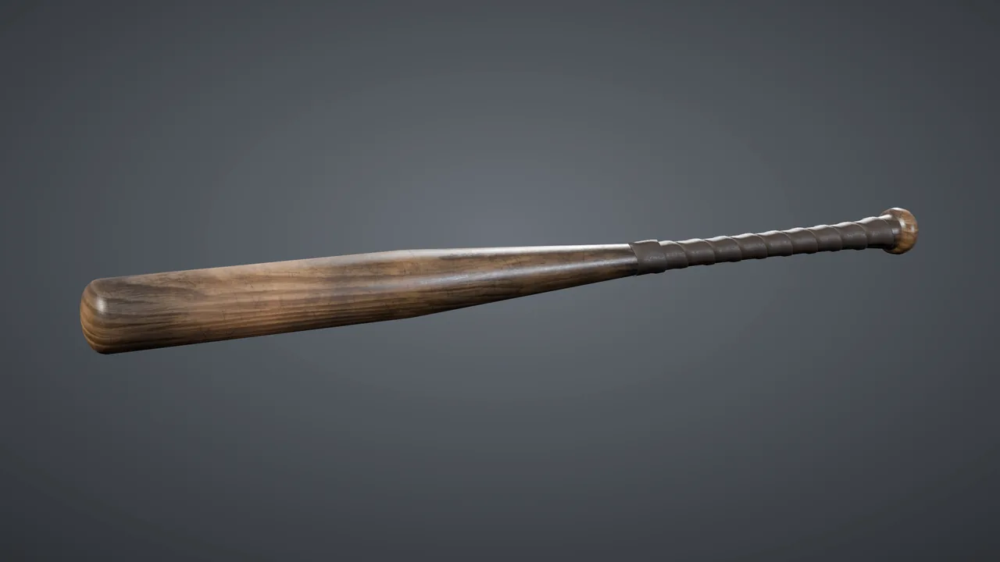

**Melee** `zz_bat`. A wooden baseball bat. A quick, wide swing that keeps things at arm's length.

| Default | |
| --- | --- |
| Damage | 45 (blade) |
| Fire rate | one swing every 0.5 s |
| Reach | 2 m |
| Swing arc | 40 deg |
| Draw time | 0.2 s |
| Weight | 1.1 kg |

*Rates are the time between shots and ignore reloading; rpm is the cyclic rate of an automatic weapon.*

### Crowbar

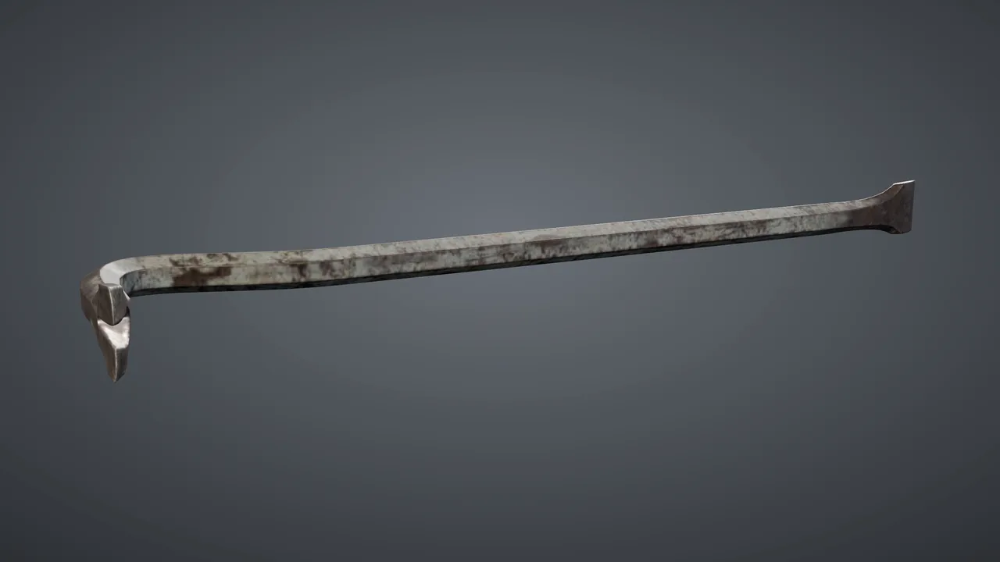

**Melee** `zz_crowbar`. Steel, a hooked end and a fast swing. It opens doors and other problems.

| Default | |
| --- | --- |
| Damage | 55 (blade) |
| Fire rate | one swing every 0.46 s |
| Reach | 1.9 m |
| Swing arc | 30 deg |
| Draw time | 0.18 s |
| Weight | 1 kg |

*Rates are the time between shots and ignore reloading; rpm is the cyclic rate of an automatic weapon.*

### Axe

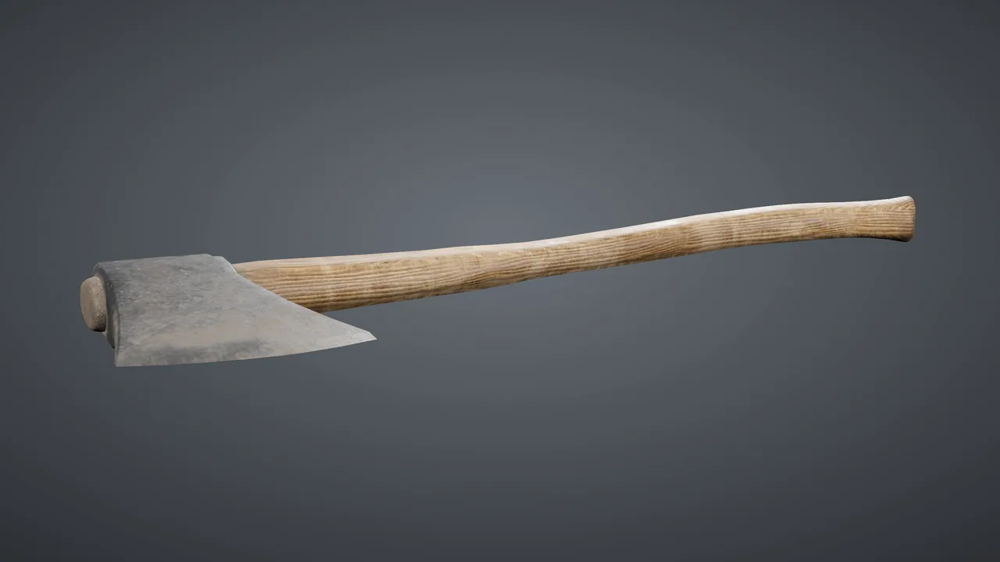

**Melee** `zz_axe`. A wood-handled axe. Slow and heavy, and it hits like one.

| Default | |
| --- | --- |
| Damage | 85 (blade) |
| Fire rate | one swing every 0.8 s |
| Reach | 2 m |
| Swing arc | 32 deg |
| Draw time | 0.3 s |
| Weight | 1.6 kg |

*Rates are the time between shots and ignore reloading; rpm is the cyclic rate of an automatic weapon.*

### Sledgehammer

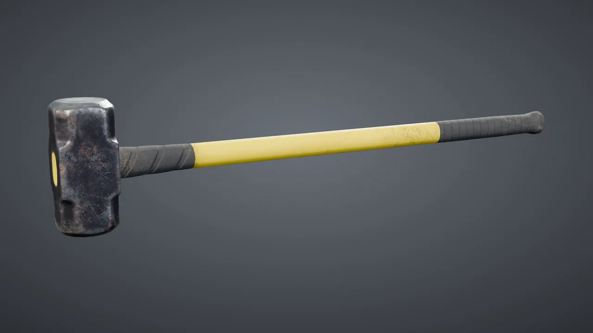

**Melee** `zz_sledge`. The heaviest hit in the pack, at the slowest swing. Commit to every one.

| Default | |
| --- | --- |
| Damage | 140 (blade) |
| Fire rate | one swing every 1.5 s |
| Reach | 2.2 m |
| Swing arc | 44 deg |
| Draw time | 0.45 s |
| Weight | 4.5 kg |

*Rates are the time between shots and ignore reloading; rpm is the cyclic rate of an automatic weapon.*
<!-- /gen_readme:weapons -->

<!-- gen_readme:quality -->
## Quality and ongoing improvement

The models, textures, animations, sounds and maps in this pack are improved automatically and recursively by AI agents. [Nightly](https://github.com/gamemann/nightly) keeps a board of improvement items. Agents pick up an item, make the change, render fresh frames and check them with a visual judge. Judge findings become new items, and the loop repeats until the result is production quality. Improvements ship as new pack versions, and the screenshots in this README are re-shot each time. Some assets are still low quality today. A reviewed asset audit (RSI, the repeated scoring of every weapon's model, textures, animations and sockets) ranks the weakest first: its latest pass re-baked the textures of 18 weapons from the authors' original maps (colour up to 2048 px), taking the pack from 2 to 20 of 28 weapons passing the high tier; the vss, scar, hunting rifle and four melee weapons are still on the list.
<!-- /gen_readme:quality -->

## Credits

Only CC0 and CC BY models are used. Each was decimated and re-textured for this pack. Full change notes are in [CREDITS.md](CREDITS.md); a game can show `ZzSpawnProvider.credits_line()`. The attachment models are built from Godot primitives in this repository. The code is MIT, see [LICENSE](LICENSE).

| Weapon | Model | Author | Licence | Source |
| --- | --- | --- | --- | --- |
| `zz_vss` | Special Sniper Rifle VSS Vintorez | Arms Museum | CC0 1.0 | [link](https://sketchfab.com/3d-models/special-sniper-rifle-vss-vintorez-4d5d8c1b7b79429abfa4816f18330089) |
| `zz_m4` | Classic M4 | SpatialNeglect (Mateusz Woliński) | CC BY 4.0 | [link](https://sketchfab.com/3d-models/classic-m4-a747ebdbb3d941ecb09b459c62865a75) |
| `zz_sniper` | Sniper | DJMaesen | CC BY 4.0 | [link](https://sketchfab.com/3d-models/sniper-cdefd833b4b5407ba32c53c9e7f50cae) |
| `zz_knife` | Fighting Ka-Bar knifes | vitvitskyi | CC BY 4.0 | [link](https://sketchfab.com/3d-models/fighting-ka-bar-knifes-b3c3a8c7c28349268f6631567cf01d8a) |
| `zz_pistol` | Vis P35(p) pistol | Virtual Museums of Małopolska | CC0 1.0 | [link](https://sketchfab.com/3d-models/vis-p35p-pistol-babe98e5485241f1971c10544f2ff796) |
| `zz_shotgun` | Shotgun | Virtual Museums of Małopolska | CC0 1.0 | [link](https://sketchfab.com/3d-models/shotgun-3c3ed272927c4f3d83d607b2acbf7aab) |
| `zz_smg` | SMG-M32 | Frostoise | CC BY 4.0 | [link](https://sketchfab.com/3d-models/smg-m32-3a5f98f75e804e5888379cbe640cc883) |
| `zz_frag` | M69 Frag Grenade | Riley Lewand | CC BY 4.0 | [link](https://sketchfab.com/3d-models/m69-frag-grenade-e94d90f68bdb4fd68d7a0aac6d9c5dd0) |
| `zz_revolver` | GameReady: Colt Python Revolver | HYQQM | CC BY 4.0 | [link](https://sketchfab.com/3d-models/gameready-colt-python-revolver-3def6e3980e64dfa832f298004ce1b94) |
| `zz_mp5` | HK MP5 (9mm submachine gun) | quick_loop | CC BY 4.0 | [link](https://sketchfab.com/3d-models/hk-mp5-9mm-submachine-gun-c503d96157614fb78b5953d49e643b78) |
| `zz_spas` | SPAS 12 shotgun | quick_loop | CC BY 4.0 | [link](https://sketchfab.com/3d-models/spas-12-shotgun-a0f118ec8a984f09b602fb3a54f56a9e) |
| `zz_lmg` | M249 Machine Gun | Kendrick Russell | CC BY 4.0 | [link](https://sketchfab.com/3d-models/m249-machine-gun-bf0105376a2d4c37926f3ce95316460d) |
| `zz_dmr` | M14 RIFLE | Ecler | CC BY 4.0 | [link](https://sketchfab.com/3d-models/m14-rifle-94920332fc7a4d63939b88a8a54baead) |
| `zz_m79` | M79 Grenade Launcher | denis1.eremin | CC BY 4.0 | [link](https://sketchfab.com/3d-models/m79-grenade-launcher-f1309916894a45e3ae6eb24f17f728d4) |
| `zz_ak` | AK-47 (Assault rifle) | quick_loop | CC BY 4.0 | [link](https://sketchfab.com/3d-models/ak-47-assault-rifle-46a36e92379341d495fdcd7750a7ebc3) |
| `zz_scar` | Low-Poly FN SCAR-H, SF inspired attachments | notcplkerry | CC BY 4.0 | [link](https://sketchfab.com/3d-models/low-poly-fn-scar-h-sf-inspired-attachments-6687ac94f30d4d8abd0fb3df6924c650) |
| `zz_bren` | low-poly CZ Bren 2 | D_U | CC BY 4.0 | [link](https://sketchfab.com/3d-models/low-poly-cz-bren-2-90b2de2d55e9458f9c7d8ffeac9003af) |
| `zz_glock` | glock 17 | Friendly | CC BY 4.0 | [link](https://sketchfab.com/3d-models/glock-17-ccf58223a7804de8b15d1d35b7d0b587) |
| `zz_deagle` | Desert Eagle | ELIZION | CC BY 4.0 | [link](https://sketchfab.com/3d-models/desert-eagle-cabde59f5cf24effaf80536e35d04e95) |
| `zz_p90` | Low-Poly FN P90 | TastyTony | CC BY 4.0 | [link](https://sketchfab.com/3d-models/low-poly-fn-p90-96b61ebbbf154843b621ebf7f48647fc) |
| `zz_aa12` | AA-12 (Low Poly) | Jawa | CC BY 4.0 | [link](https://sketchfab.com/3d-models/aa-12-low-poly-3200bd6ec351461bae6853ba8c47e3ff) |
| `zz_rpg` | RPG-7 | Tactical_Beard | CC BY 4.0 | [link](https://sketchfab.com/3d-models/rpg-7-01c0fa7bb9e0439cac27264b3119a3fd) |
| `zz_machete` | Machete | Ulan Cabanilla | CC0 1.0 | [link](https://polyhaven.com/a/machete) |
| `zz_bat` | Baseball Bat | Enrique Martín | CC0 1.0 | [link](https://polyhaven.com/a/baseball_bat) |
| `zz_crowbar` | Crowbar 01 | Alexander Otterbeck | CC0 1.0 | [link](https://polyhaven.com/a/crowbar_01) |
| `zz_axe` | Wooden Axe 02 | Ulan Cabanilla | CC0 1.0 | [link](https://polyhaven.com/a/wooden_axe_02) |
| `zz_sledge` | Sledgehammer 01 | Dylan Guzman | CC0 1.0 | [link](https://polyhaven.com/a/sledgehammer_01) |
| `zz_hunting` | Bolt Action Rifle 7.62 | Mateusz Sadek | CC0 1.0 | [link](https://polyhaven.com/a/bolt_action_rifle_7_62) |
