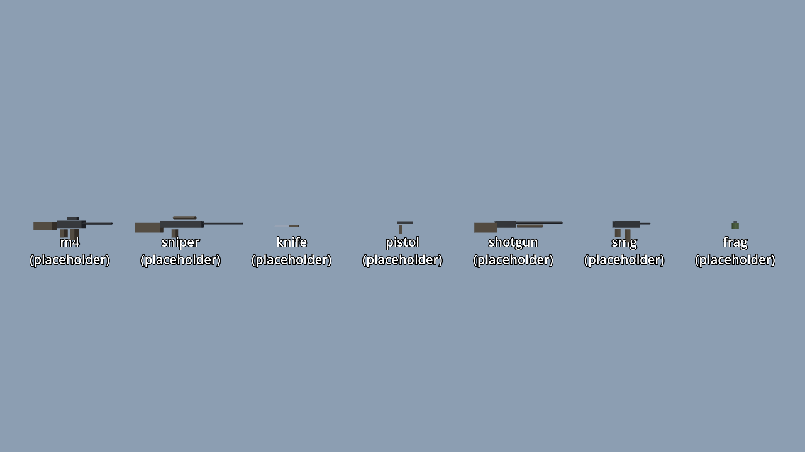

# zz-modern-weapons

Twenty-eight modern weapons for [dot-weapon](https://github.com/modcommunity/dot-weapon): rifles, carbines, SMGs, pistols, shotguns, snipers, a machine gun, launchers, a frag grenade and six melee weapons (knife, machete, bat, crowbar, axe, sledgehammer). Made for Zombie Zone, usable in any game or server through Dot (`provides.json`, kind `weapon`, games `*`). The addon is `addons/zz_modern_weapons`.



Every weapon has a decimated PBR model. Metal keeps its authored values, so the view that draws it must give it something to reflect: see [docs/lighting.md](docs/lighting.md). Each weapon also has a `weight` in kg in its profile.

## Using it

```gdscript
var catalogue := ZzWeaponPack.catalogue()      # a DotWeaponCatalogue
var model := ZzWeaponArt.instantiate(ZzWeaponIds.M4)
```

A game's spawn menu calls `ZzSpawnProvider.spawn_entries()` (in `addons/zz_modern_weapons/spawn_provider.gd`) and gets one `{category, id, name, icon, kind: "weapon", spawn, cfg_hint}` row per weapon. The Workshop form (`weapons/*.tres` and `provides.json`) is generated by `tools/export-defs.sh`.

## Settings

Every number is in a weapon profile, `cfg/addons/zz_modern_weapons/weapon/<id>.yml`: common keys at the top (damage, rate, recoil, spread, magazine, reload, range), the pack's own under `extra:`, and a `menu:` block. A weapon with upgrades has a folder with `upgrades/<id>.yml` (the rifle and the shotgun do).

```yaml
m4:
  damage: 35
  rpm: 700
  magazine: 20
```

Put your own changes in `cfg/game/<game>/weapon/` or `cfg/server/weapon/` and leave the shipped files alone. A key you do not list keeps its default; an unknown key is logged and ignored.

## Testing

`./game.sh test` parses every script and runs the pack's suite. `tools/screenshot.sh [--all|<weapon>]` renders the rack to `screenshots/`.

## Credits

Only CC0 and CC BY models are used. Each was decimated and re-textured for this pack. Full change notes are in [CREDITS.md](CREDITS.md); a game can show `ZzSpawnProvider.credits_line()`. The attachment models are built from Godot primitives in this repository. The code is MIT, see [LICENSE](LICENSE).

| Weapon | Model | Author | Licence | Source |
| --- | --- | --- | --- | --- |
| `zz_vss` | Special Sniper Rifle VSS Vintorez | Arms Museum | CC0 1.0 | [link](https://sketchfab.com/3d-models/special-sniper-rifle-vss-vintorez-4d5d8c1b7b79429abfa4816f18330089) |
| `zz_m4` | Classic M4 | SpatialNeglect (Mateusz Woliński) | CC BY 4.0 | [link](https://sketchfab.com/3d-models/classic-m4-a747ebdbb3d941ecb09b459c62865a75) |
| `zz_sniper` | Sniper | DJMaesen | CC BY 4.0 | [link](https://sketchfab.com/3d-models/sniper-cdefd833b4b5407ba32c53c9e7f50cae) |
| `zz_knife` | Fighting Ka-Bar knifes | vitvitskyi | CC BY 4.0 | [link](https://sketchfab.com/3d-models/fighting-ka-bar-knifes-b3c3a8c7c28349268f6631567cf01d8a) |
| `zz_pistol` | Vis P35(p) pistol | Virtual Museums of Małopolska | CC0 1.0 | [link](https://sketchfab.com/3d-models/vis-p35p-pistol-babe98e5485241f1971c10544f2ff796) |
| `zz_shotgun` | Shotgun | Virtual Museums of Małopolska | CC0 1.0 | [link](https://sketchfab.com/3d-models/shotgun-3c3ed272927c4f3d83d607b2acbf7aab) |
| `zz_smg` | SMG-M32 | Frostoise | CC BY 4.0 | [link](https://sketchfab.com/3d-models/smg-m32-3a5f98f75e804e5888379cbe640cc883) |
| `zz_frag` | M69 Frag Grenade | Riley Lewand | CC BY 4.0 | [link](https://sketchfab.com/3d-models/m69-frag-grenade-e94d90f68bdb4fd68d7a0aac6d9c5dd0) |
| `zz_revolver` | GameReady: Colt Python Revolver | HYQQM | CC BY 4.0 | [link](https://sketchfab.com/3d-models/gameready-colt-python-revolver-3def6e3980e64dfa832f298004ce1b94) |
| `zz_mp5` | HK MP5 (9mm submachine gun) | quick_loop | CC BY 4.0 | [link](https://sketchfab.com/3d-models/hk-mp5-9mm-submachine-gun-c503d96157614fb78b5953d49e643b78) |
| `zz_spas` | SPAS 12 shotgun | quick_loop | CC BY 4.0 | [link](https://sketchfab.com/3d-models/spas-12-shotgun-a0f118ec8a984f09b602fb3a54f56a9e) |
| `zz_lmg` | M249 Machine Gun | Kendrick Russell | CC BY 4.0 | [link](https://sketchfab.com/3d-models/m249-machine-gun-bf0105376a2d4c37926f3ce95316460d) |
| `zz_dmr` | M14 RIFLE | Ecler | CC BY 4.0 | [link](https://sketchfab.com/3d-models/m14-rifle-94920332fc7a4d63939b88a8a54baead) |
| `zz_m79` | M79 Grenade Launcher | denis1.eremin | CC BY 4.0 | [link](https://sketchfab.com/3d-models/m79-grenade-launcher-f1309916894a45e3ae6eb24f17f728d4) |
| `zz_ak` | AK-47 (Assault rifle) | quick_loop | CC BY 4.0 | [link](https://sketchfab.com/3d-models/ak-47-assault-rifle-46a36e92379341d495fdcd7750a7ebc3) |
| `zz_scar` | Low-Poly FN SCAR-H, SF inspired attachments | notcplkerry | CC BY 4.0 | [link](https://sketchfab.com/3d-models/low-poly-fn-scar-h-sf-inspired-attachments-6687ac94f30d4d8abd0fb3df6924c650) |
| `zz_bren` | low-poly CZ Bren 2 | D_U | CC BY 4.0 | [link](https://sketchfab.com/3d-models/low-poly-cz-bren-2-90b2de2d55e9458f9c7d8ffeac9003af) |
| `zz_glock` | glock 17 | Friendly | CC BY 4.0 | [link](https://sketchfab.com/3d-models/glock-17-ccf58223a7804de8b15d1d35b7d0b587) |
| `zz_deagle` | Desert Eagle | ELIZION | CC BY 4.0 | [link](https://sketchfab.com/3d-models/desert-eagle-cabde59f5cf24effaf80536e35d04e95) |
| `zz_p90` | Low-Poly FN P90 | TastyTony | CC BY 4.0 | [link](https://sketchfab.com/3d-models/low-poly-fn-p90-96b61ebbbf154843b621ebf7f48647fc) |
| `zz_aa12` | AA-12 (Low Poly) | Jawa | CC BY 4.0 | [link](https://sketchfab.com/3d-models/aa-12-low-poly-3200bd6ec351461bae6853ba8c47e3ff) |
| `zz_rpg` | RPG-7 | Tactical_Beard | CC BY 4.0 | [link](https://sketchfab.com/3d-models/rpg-7-01c0fa7bb9e0439cac27264b3119a3fd) |
| `zz_machete` | Machete | Ulan Cabanilla | CC0 1.0 | [link](https://polyhaven.com/a/machete) |
| `zz_bat` | Baseball Bat | Enrique Martín | CC0 1.0 | [link](https://polyhaven.com/a/baseball_bat) |
| `zz_crowbar` | Crowbar 01 | Alexander Otterbeck | CC0 1.0 | [link](https://polyhaven.com/a/crowbar_01) |
| `zz_axe` | Wooden Axe 02 | Ulan Cabanilla | CC0 1.0 | [link](https://polyhaven.com/a/wooden_axe_02) |
| `zz_sledge` | Sledgehammer 01 | Dylan Guzman | CC0 1.0 | [link](https://polyhaven.com/a/sledgehammer_01) |
| `zz_hunting` | Bolt Action Rifle 7.62 | Mateusz Sadek | CC0 1.0 | [link](https://polyhaven.com/a/bolt_action_rifle_7_62) |
