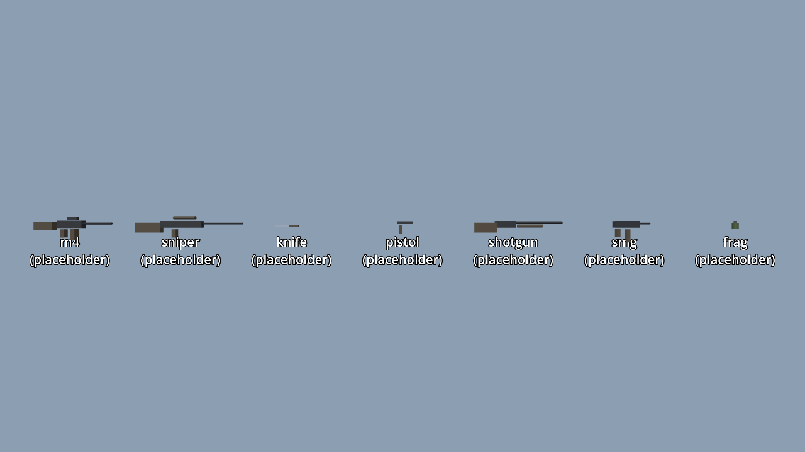

# Zee's Modern Weapons

Modern, realistic weapons on top of [dot-weapon](../dot-weapon): M4 carbine, sniper rifle, VSS, combat knife, pistol, magnum revolver, pump and combat shotguns, SMG and MP5, M14 marksman rifle, light machine gun, grenade launcher, frag grenade, and (added 2026-10-26) an assault rifle, battle rifle, bullpup carbine, service pistol, hand cannon, compact SMG, automatic shotgun, rocket launcher and machete. Made for Zombie Zone, usable in any game or server through Dot (`provides.json` kind `weapon`, games `*`). Addon `zz_modern_weapons`.



## Status

The rows (damage, rate, recoil, spread, magazine, reload, range) are done, tested and configurable. **Every weapon is a real decimated PBR model** (the VSS Vintorez and the two Małopolska models CC0, the rest CC-BY, and each has a `weight` (kg) in its profile for the planned weight system; [CREDITS.md](CREDITS.md) has uid, author and licence). Metal is at its authored values, so the view that draws it must give it something to reflect: [docs/lighting.md](docs/lighting.md).

## Tuning

Every number is in a weapon profile, `cfg/addons/zz_modern_weapons/weapon/<id>.yml` (dot-weapon `DotWeaponProfiles`): the common keys at the top, the pack's own under `extra:`, a `menu:` block, and a folder with `upgrades/<id>.yml` for a weapon that has upgrades (the rifle and the shotgun do). Keep your own changes in `cfg/game/<game>/weapon/` or `cfg/server/weapon/` and leave the shipped files alone. A weapon or key you do not list keeps its default; an unknown key is logged and ignored. Old one-file ymls (a top-level key per weapon, directly in `cfg/addons/zz_modern_weapons/`) are still read and win over the profiles.

```yaml
m4:
  damage: 35
  rpm: 700
  magazine: 20
```

## Using it

```gdscript
var catalogue := ZzWeaponPack.catalogue()      # a DotWeaponCatalogue, validates with no art
var model := ZzWeaponArt.instantiate(ZzWeaponIds.M4)
```

A host's spawn menu calls `ZzSpawnProvider.spawn_entries()` (`addons/zz_modern_weapons/spawn_provider.gd`) and gets one `{category: "Weapons", id, name, icon, kind: "weapon", spawn, cfg_hint}` row per weapon.

The Workshop form (`weapons/*.tres`, `provides.json`) is generated from the code by `tools/export-defs.sh`; the suite fails when it is stale.

## Testing

`./game.sh test` parses every script and runs `zz_selftest`. `tools/screenshot.sh [--all|<weapon>]` renders the rack to `screenshots/` (look at it; no assertion reaches how a weapon looks).

## Art and licences

See [CREDITS.md](CREDITS.md); a host shows `ZzSpawnProvider.credits_line()` (rows in `credits()`, table in `zz_weapon_credits.gd`). Only CC0 and CC-BY models are used, with URL, author and licence recorded there. Code is MIT.
